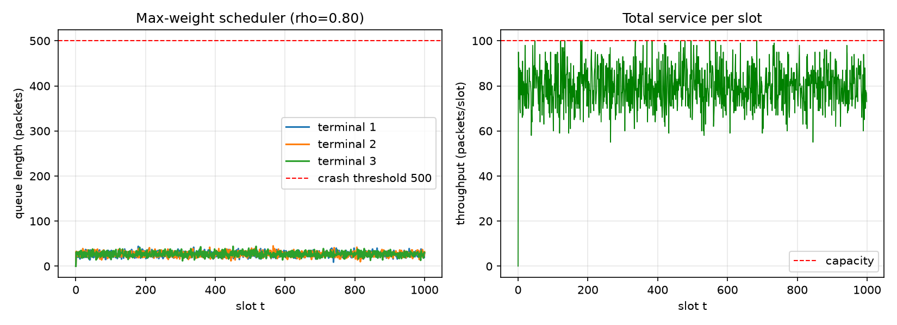
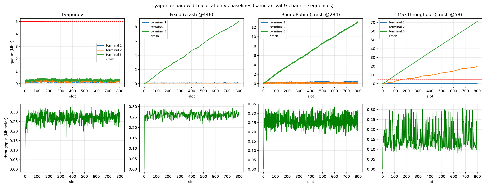
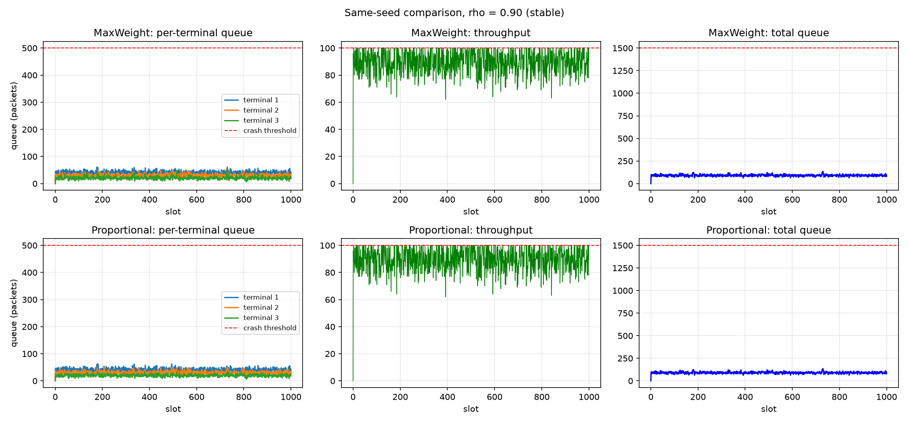
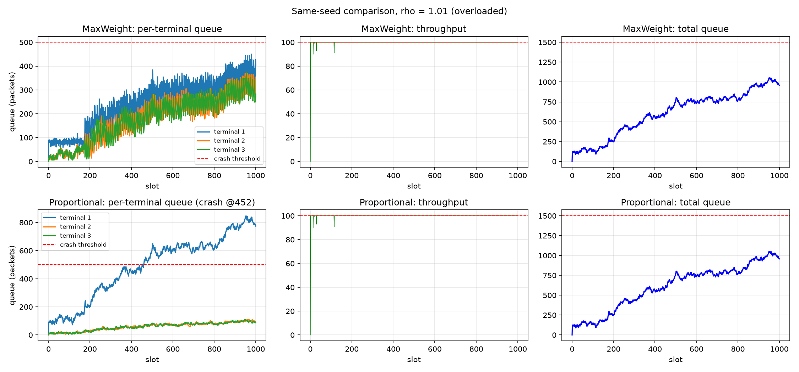

# lyapunov-scheduling-demo

**Lyapunov optimization in ~100 lines.** Three small, runnable scripts that
show *why* max-weight scheduling keeps queues stable — from an abstract
shared-downlink toy to a Shannon-rate bandwidth-allocation problem with a
numerical solver.

[中文说明](README.zh-CN.md) · [理论伴读 (tutorial, 中文)](docs/tutorial.md)

|  |  |
|---|---|
|  |  |

## What you will learn

1. **Drift bound → max-weight in one step.** Lyapunov function
   `L(t) = ½·Σ Q²`, the drift bound `Δ ≤ B + Σ Q·(λ − V)`, and why minimizing
   drift reduces to "serve the longest queue" (`01`).
2. **The same objective with a real physical layer.** Replace service amounts
   with Shannon rates, allocate bandwidth per slot with SLSQP, and watch the
   scheduler adapt to a load/assignment mismatch that breaks every static
   policy (`02`).
3. **What scheduler comparisons actually measure.** With the *same* arrival
   sequence: work-conserving schedulers tie on mean total queue (Little's
   law) and differ only in the *tail* — max queue and crash time (`03`).

## The three scripts

| Script | Model | Lesson |
|---|---|---|
| `01_basic_max_weight.py` | abstract queues, closed-form max-weight | drift bound → greedy longest-queue-first |
| `02_channel_bandwidth.py` | Shannon rates, SLSQP bandwidth split, 4 schedulers | throughput-optimal ≠ queue-stable |
| `03_same_seed_compare.py` | identical arrivals, max-weight vs proportional | work conservation: same mean, different tail |

## Headline results (from the scripts as shipped, seeds fixed)

**02 — load/assignment mismatch**: terminal 3's arrival (95 kbit/slot)
deliberately exceeds its equal-split service rate (87.2). Same arrival and
channel sequences for all four schedulers:

| Scheduler | Outcome |
|---|---|
| **Lyapunov (max-weight)** | **survives**, max queue ≈ 464 kbit |
| Fixed equal split | crash @ slot 446 |
| Round robin | crash @ slot 284 |
| Max-throughput | crash @ slot 58 — throughput-optimal, queue-unstable |

**03 — same seed, ρ = 0.9 vs ρ = 1.01**:

- stable: both schedulers average the *same* total queue (90.86) — but
  max-weight flattens queues (`[61, 58, 61]`) while proportional mirrors the
  arrival imbalance (`[63, 51, 35]`);
- overloaded: no scheduler escapes ρ > 1, but max-weight keeps the max queue
  at 450 vs 848 and proportional crashes first (@452).

## Quick start

```bash
pip install -r requirements.txt

python 01_basic_max_weight.py
python 02_channel_bandwidth.py          # takes ~10 s (SLSQP per slot)
python 03_same_seed_compare.py          # stable scenario
python 03_same_seed_compare.py --overload

python -m pytest tests/ -q              # 17 tests
```

Figures are written to `figures/`. Add `--show` to pop up plot windows.

Tuning knobs worth playing with (all at the top of each script): `RHO` /
`R_MEAN` (push ρ past 1 and watch everything crash), `PSI` (set it too large
and max-weight degenerates toward throughput-max — see the Ψ note in `02`),
`Q_MAX`, `SEED`.

## Theory companion

[docs/tutorial.md](docs/tutorial.md) (Chinese) walks through the drift-bound
derivation, the max-weight reduction, the Ψ and N₀ engineering traps, and
how this skeleton extends to real systems (virtual queues for energy, DRL
solvers).

## Origins

The framework follows M. J. Neely,
*Stochastic Network Optimization with Application to Communication and
Queueing Systems* (Morgan & Claypool, 2010). The exercises were written
while studying LEO-satellite IoT access-control scheduling
(cf. *"Joint Optimization of Access Control and Resource Allocation for LEO
Satellite IoT Using Deep Reinforcement Learning"*, IEEE TCCN 2026) —
this repo reimplements the Lyapunov core for teaching, not the paper's model.

## License

MIT — see [LICENSE](LICENSE).
